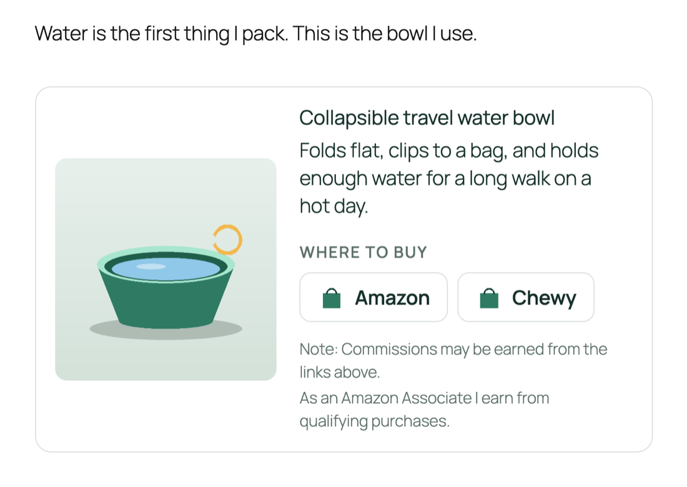

# Where to Buy

**Website and guide: https://bignall.github.io/where-to-buy/**

A WordPress plugin for the things you recommend: a photo, a short description and a button for each store that sells it. Only links that work are shown, and the affiliate disclosure is added for you.



- **Stores, set up once:** name, button image, allowed domains, affiliate tag and extra disclosure, in the order you choose.
- **Only working links show:** each link must go to that store's own site, and the editor says why any link is hidden.
- **Disclosures built in:** your note under the buttons, plus Amazon's required Associates sentence whenever an Amazon button shows.
- **Place items anywhere:** item pages, a list page, the Where to Buy block, and shortcodes.
- **Works with [Affiliate Link Cloaker](https://bignall.github.io/aff-link-cloaker/)** for counted, cloaked links.

## Install

Download `where-to-buy-x.y.z.zip` from the [latest release](https://github.com/bignall/where-to-buy/releases/latest) and upload it under **Plugins → Add New → Upload Plugin**. Requires PHP 8.1+ and WordPress 6.4+.

## Build from source

```bash
composer install      # installs WP Foundation and prefixes it with Strauss
bin/build-zip.sh      # writes dist/where-to-buy-<version>.zip
```

Pushing a tag such as `v0.3.1` that matches the `Version:` header builds the zip and publishes a GitHub release. Notes come from `release-notes/<tag>.md`.

Built on [WP Foundation](https://bignall.github.io/wp-foundation/). GPL-2.0-or-later.
